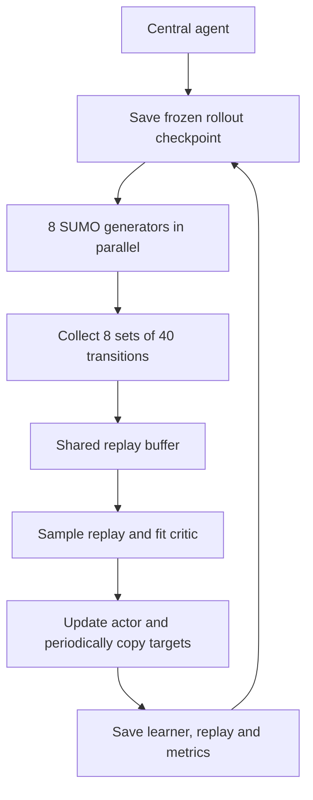

# Running and understanding shared-green RL

This guide starts with an unpacked folder and ends with a completed training run.
It describes the code included here, rather than earlier experimental versions.
You do not need the original repository or `direct_rl` package.

## 1. What this program does

The program trains one DDPG controller for 17 traffic lights in the Luxembourg
SUMO Traffic (LuST) scenario. SUMO simulates vehicles; Python reads traffic
conditions and changes the lights through TraCI, SUMO's control interface.

Region A is a selected set of road edges. Region B contains the other
non-internal edges. Every 90 simulated seconds, the agent chooses **one number**:
the total B-to-A green time to assign at **each** controlled light. This is not
17 independent commands. With the supplied network and minimum green setting,
the number lies between 10 and 55 seconds.

The aim of training is to increase completed trips. Travel time is also recorded
so you can see whether more completions are accompanied by lower congestion.
The current reward has no separate antifragile derivative or redundancy term;
accumulation differences are part of the observations.

Eight generators means eight separate SUMO simulations collecting experience
for **one shared learner**. It does not mean eight independently trained agents
or one SUMO simulation distributed across eight cores.

## 2. Install and check the environment

Use Python 3.12 and SUMO 1.24.0 to match the environment used for the existing
experiments. SUMO is a separate installation; `requirements.txt` installs NumPy
and PyTorch only. The agent runs on CPU; there is no GPU option in this code.

Open a terminal in `shared_green_rl_core`, the folder containing `ddpg_agent.py`,
`requirements.txt`, and the inner `shared_green_rl` directory. All following
commands assume this working directory.

### Windows PowerShell

```powershell
cd "C:\path\to\shared_green_rl_core"
py -3.12 -m venv .venv
.\.venv\Scripts\Activate.ps1
python -m pip install -r requirements.txt
```

If activating the environment is inconvenient, use `.\.venv\Scripts\python.exe`
in place of `python` in subsequent commands. Install packages with that same
interpreter. Adding a different Python to PATH does not install PyTorch into
your virtual environment.

Set these paths to your actual SUMO installation if they are not already set:

```powershell
$env:SUMO_HOME = "C:\path\to\SUMO"
$env:PATH = "$env:SUMO_HOME\bin;$env:PATH"
sumo --version
python -c "import sys, numpy, torch; print(sys.executable); print(numpy.__version__, torch.__version__)"
```

`SUMO_HOME` should contain `tools/traci`. The code also tries the `tools` folder
beside SUMO's `bin` directory. These PowerShell environment settings apply to
the current terminal.

### Linux server

```bash
cd /path/to/shared_green_rl_core
python3.12 -m venv .venv
source .venv/bin/activate
python -m pip install -r requirements.txt
sumo --version
python -c "import sys, numpy, torch; print(sys.executable); print(numpy.__version__, torch.__version__)"
```

Install SUMO using your server's normal installation process. If needed, set
`SUMO_HOME` to the directory containing its `tools` folder and put the directory
containing `sumo` on PATH. Use the headless `sumo` executable for parallel runs.

To check the Python entry point without launching a simulation:

```sh
python -B -m shared_green_rl.train_parallel --help
```

Use `-m shared_green_rl.train_parallel`, rather than executing the inner Python
file directly. `-B` simply prevents creation of Python bytecode cache files.

## 3. Make a small first run

The following command runs two generators for one 90-second cycle each, then
performs a small central learning update. It is an installation check, not a
meaningful training experiment. Its time feature spans the shortened episode.

```sh
python -B -m shared_green_rl.train_parallel --training-mode reference --episodes 1 --generators 2 --duration 90 --train-sample-size 2 --critic-epochs 2 --critic-batch-size 2 --critic-patience 2 --output outputs/first_check
```

Wait for the command to finish. A successful run prints a final dictionary with
`generators: 2` and `transitions: 2`, and creates `episodes.csv`, `agent.pt`,
and generator subfolders under `outputs/first_check`.

Every run needs a **new output directory**. Repeating this command with the same
output path raises `FileExistsError`; use `outputs/first_check_2` instead.
Do not resume this short check as a one-hour experiment.

## 4. Run the usual one-hour experiment

This command explicitly selects the reference training procedure, 50 rounds,
eight generators, and the settings used in our recent experiments. It is one
line so it works in both PowerShell and Bash.

```sh
python -B -m shared_green_rl.train_parallel --training-mode reference --episodes 50 --generators 8 --train-sample-size 1000 --critic-epochs 128 --critic-batch-size 256 --critic-validation-fraction 0.2 --critic-patience 20 --actor-steps 2 --target-update-period 5 --noise 2 --seed 42 --sumo-seed 42 --exploration-seed 10000 --begin 28800 --duration 3600 --min-green 5 --state-scale 1000 --derivative-scale 100 --output outputs/reference_training
```

**Keep `--training-mode reference` in a fresh-run command.** The CLI's preserved
default is `legacy`, and its default episode count is 10, not 50.

Here, one logged episode is one collection-and-learning round:

1. Save the current policy as `episode_000/rollout_agent.pt`.
2. Start eight independent SUMO rollouts using that frozen policy.
3. Each rollout simulates 08:00-09:00 and collects 40 transitions.
4. Wait for all eight rollouts, then add their 320 transitions to central replay.
5. Update the critic and actor centrally.
6. Save the updated learner, replay buffer and metrics; start the next round.

There are 50 such rounds, indexed 0-49. That means 400 one-hour SUMO rollouts,
with at most eight running at once. Simulated time is not wall-clock time.
No worker learns while its rollout is running.



The default eight workers can use multiple CPU cores because each has its own
SUMO process. Each worker limits PyTorch to one thread. The central learner's
one-thread setting is currently commented out, so it uses PyTorch's normal
thread settings. Adjust `--generators` to the server's available CPU and memory;
more workers also change transitions collected per round and total workload.

## 5. Choose demand and simulation inputs

Without route arguments, the bundled configuration loads:

```text
LuSTScenario-master/scenario/DUARoutes/local.0.rou.xml
LuSTScenario-master/scenario/DUARoutes/local.1.rou.xml
LuSTScenario-master/scenario/transit.rou.xml
```

These are the available original-demand files for 06:00-11:00. The standard
training command uses departures in 08:00-09:00. Three experimental profiles
are also included under `scenario/`:

| Profile | Option to add to the full training command | Total trips departing 08:00-09:00 |
|---|---|---:|
| Two-stage strict | `--route-files scenario/two_stage_strict_timestate/all_demand.rou.xml` | 30,382 |
| BA+3000 second-half | `--extra-routes scenario/ba_plus3000_secondhalf/extra_ba.rou.xml` | 28,382 |
| AA+3000 | `--extra-routes scenario/aa_plus3000/extra_aa.rou.xml` | 28,382 |

Choose a new `--output` folder for each experiment. See
[scenario/README.md](scenario/README.md) for provenance, profile descriptions
and ready-to-run commands. The `timestate` name identifies the historical
experiment; the current core uses the time state for every demand profile.

If you separately obtain a supplemental file, append this option to a fresh
training command, with the real path substituted:

```text
--extra-routes "data/my_profile/extra_ba.rou.xml"
```

For a file containing the **entire replacement demand**, use:

```text
--route-files "data/my_profile/all_demand.rou.xml"
```

Use only one of these options. Appending a complete replacement file would
duplicate the original demand. Supplemental vehicle IDs must be unique across
the combined files. Routes must be compatible with the supplied network.

The network is `lust_phase_separation.net.xml`. The runtime also needs
`Region_A.txt`, `boundary_intersections.json`, `vtypes.add.xml` and
`e1detectors.phase_separation.add.xml`. Keep their relative folder structure.

SUMO options come from `dua.static_1h_phase_separation.sumocfg`. In particular,
the supplied settings include a one-second step, rerouting probability 0.70,
rerouting period/pre-period 300 seconds, time-to-teleport 600 seconds,
max-depart-delay 600 seconds and ignore-junction-blocker 20 seconds.
These are scenario settings, not training CLI flags. CLI begin/duration and
SUMO seed override the corresponding run values. Default-file paths are
resolved against the scenario folder; user-provided demand paths are resolved
against the working directory.

Each rollout writes a copied configuration and copied additional files into
its own output folder. Detector outputs are redirected there, and detector
positions use `friendlyPos="true"` in those copies. Original scenario files are
not rewritten by training. The generated filename `baseline.sumocfg` is a
historical helper name: the rollout is still controlled by the RL agent.

## 6. What the agent sees

The state has seven elements, always in this order:

| Index | Feature | Meaning | Default divisor |
|---|---|---|---:|
| 0 | `n_A` | Current vehicles assigned to A | 1000 |
| 1 | `n_B` | Current vehicles assigned to B | 1000 |
| 2 | `dn_A` | Change in A accumulation since the previous cycle | 100 |
| 3 | `dn_B` | Change in B accumulation since the previous cycle | 100 |
| 4 | `d2n_A` | Change in `dn_A` since the previous cycle | 100 |
| 5 | `d2n_B` | Change in `dn_B` since the previous cycle | 100 |
| 6 | `elapsed_fraction` | Seconds since episode start, divided by duration | Duration, normally 3600 |

For example, with raw values `[1200, 4000, 50, -100, 20, -40]` halfway through
a one-hour episode, the input is `[1.2, 4.0, 0.5, -1.0, 0.2, -0.4, 0.5]`.
Scaling is division, not clipping or a fitted statistical normalization.
Values can exceed one or be negative.

For control-cycle index `k`:

```text
dn[k]  = n[k] - n[k-1]
d2n[k] = dn[k] - dn[k-1]
```

These are finite differences per **90-second cycle**. They are not divided by
90 or 90 squared. No interregional flow `M` is included.

Region membership follows road edges. On internal junction lanes, vehicles
are assigned using their incoming route edge. Vehicles with no road ID, or no
resolvable external edge, are excluded from regional accumulation.

There is currently **no warm-up**. SUMO starts at the requested begin time,
and the first state is measured before the first simulation step. The network
is initially empty, differences are initialized to zero, and elapsed time is
zero. The first action therefore uses a zero state. The next observation is
at 08:01:30. Startup effects in the first few cycles are expected from this
initialization; the code does not simulate the preceding morning first.

## 7. What the agent outputs and how lights use it

The actor is a neural network with dimensions `7 -> 64 -> 64 -> 1`, with ReLU
hidden activations. Its final output is transformed with `tanh` into the
allowed green interval:

```text
action = low + (tanh(network(state)) + 1) * (high - low) / 2
```

Exploration adds Gaussian noise in **seconds**, then clips to the bounds.
The default standard deviation is 2 seconds and does not decay automatically.
The action is represented as an array of length one, such as `[32.5]`.

For each light, `SignalMapping.plan()` reserves the original clearance times,
assigns the requested budget to B-to-A green phases and distributes the
remaining green time evenly among A-to-B phases. Each cycle stays 90 seconds.

For an illustrative light with 10 seconds of clearance and two green phases
per direction, a 30-second action gives:

```text
B-to-A: 15 + 15 seconds
A-to-B: 25 + 25 seconds
Clearance: 10 seconds
Total: 90 seconds
```

The actual clearance total is read separately for each light. A-to-B green is
`90 - clearance - B_to_A`, not simply `90 - B_to_A`.

The mapping relies on the edited network's phase order:

- A phase containing uppercase `G` is a green service phase.
- The first green phase is B-to-A for most controlled lights.
- For `-4214`, `-8782`, `-29900`, `-17072` and `-12`, the first two green phases
  are B-to-A. Remaining green phases are A-to-B.
- Other phases retain their stored durations. A lowercase-only `g` phase is
  not selected as a green service phase by this implementation.

The code uses the first matching `tlLogic` for each selected ID. It does not
infer movement direction from lane connectivity at runtime. If you replace
the network or reorder phases, review this mapping first.

`--min-green 5` means a minimum for **each individual green phase**. Some lights
need two B-to-A phases, so the shared action must be at least `2 * 5 = 10`
seconds. The global upper bound is the smallest budget that leaves enough
green for all A-to-B phases across the 17 lights; it is 55 seconds for the
supplied network. The parameter is rounded upward to an integer by `ceil`.

Budgets and phase durations are allocated in hundredths of a second. When a
budget does not divide evenly, phases can differ by 0.01 second. SUMO still
advances on a one-second grid. Replay stores the action before this two-decimal
allocation. At each control cycle, all 17 programs are set and restarted at
phase zero; uncontrolled lights are left to their existing operation.

## 8. Reward, TTS and learning

During each 90-second action, the environment advances SUMO one second at a
time. It counts arrived vehicles and accumulates the active vehicle count.

```text
cycle_reward = completed_trips_during_cycle / 90
cycle_TTS    = sum(active_vehicle_count at each one-second step)
```

Completions are arrivals across the whole network, not just Region A or
boundary crossings. TTS is measured in vehicle-seconds for the simulated
window. It includes time accumulated by vehicles still running at the end;
it is not the mean journey time of completed trips. It does not directly count
scheduled vehicles still waiting to enter the network.

The one-hour reward sum is `completed / 90`. The logged completion rate is
`completed / 3600`. They differ by a factor of 40 for a one-hour episode.
The reward encourages more completions; lower TTS is not guaranteed.

The critic takes seven state elements plus one action and predicts a scalar
discounted return: `8 -> 64 -> 64 -> 1`. Only at the critic input is the action
converted from seconds to `[-1, 1]`.

In reference mode:

1. Sample up to 1,000 transitions without replacement from the shared replay
   buffer. Older rounds remain eligible; the buffer holds at most 10,000.
2. Calculate fixed targets `reward + gamma * (1-done) * target_Q(next_state,
   target_actor(next_state))` once for that round.
3. Hold out 20% of the sample for validation and fit the critic on the rest.
   Training order is reshuffled each epoch; validation membership and targets
   stay fixed. Stop after 128 epochs or 20 consecutive epochs without a lower
   validation loss. The **last** critic weights are retained, not the weights
   from the best validation epoch.
4. Take two actor optimizer steps using all sampled states while critic
   parameters are frozen. Actor loss is negative mean predicted Q.
5. Every five completed reference updates, copy the current actor and critic
   into their target networks.

In the first full round, only 320 transitions exist: 256 are used for critic
training and 64 for validation. Once the sample reaches 1,000, the split is
800/200, with four critic minibatches per epoch at batch size 256. Reusing this
sample over many epochs is intentional. `--batch-size 32` is a legacy-mode
setting and does not determine these reference-mode minibatches.

The environment sets `done=True` at the end of the requested duration, and
the generator stores it as terminal. Consequently, the last transition's
target does not bootstrap beyond the episode, even though the general agent
API distinguishes terminal states from time-limit truncations.

Legacy mode instead samples a fresh minibatch for each update, updates actor
and critic together, and softly updates targets. It remains in the package
for compatibility; choose the mode explicitly when comparing experiments.

## 9. Find and interpret outputs

```text
outputs/reference_training/
  settings.json                 Arguments, state scales, bounds and agent settings
  episodes.csv                  One aggregate row per completed round
  generators.csv                One row per generator per round
  agent.pt                      Most recently saved learner, AFTER central updates
  replay_buffer.json            Shared replay needed for resume
  episode_000/
    rollout_agent.pt            Frozen policy used to collect this round
    training.json               Reference-mode losses and critic epoch history
    generator_000/
      episode.json             This simulation's reward, TTS, completion, timing
      samples.json             Its state/action/reward/next-state/done transitions
      baseline.sumocfg          Generated SUMO configuration
      additional_*.xml          Copied additional inputs
      ...                      SUMO summary, tripinfo, detector files and log
```

Each item in `samples.json` is `[state, action, reward, next_state, done]`.
States are already normalized. Multiply the first six elements by the recorded
divisors to recover counts/differences. The seventh element is elapsed fraction.

| Metric | Interpretation |
|---|---|
| `mean_tts` | Arithmetic mean TTS across this round's generators; lower is better |
| `mean_completed` | Mean completed trips across generators; higher is better |
| `mean_completion_rate` | Mean completions per simulated second |
| `mean_reward` | Mean sum of the 40 cycle rewards |
| `transitions` | Total new transitions across generators, normally 320 |
| `collection_seconds` | Wall time for collection, including rollout overhead and waiting |
| `training_seconds` | Wall time for the central phase, including replay/file work |
| `elapsed_seconds` | Overall round wall time |
| `actor_loss`, `critic_loss` | Central learner statistics; not averages of worker losses |
| `updates` | Legacy update count; deliberately blank in reference mode |
| `critic_optimizer_steps`, `actor_optimizer_steps` | Actual optimizer step counts in reference mode |

The row for episode 21 measures rollouts from `episode_021/rollout_agent.pt`.
It does **not** measure the policy after that round's subsequent learning.
The root `agent.pt` is overwritten each round and is not an archive of every
post-update policy.

The reference critic validation set consists of replay transitions. It is not
a separate SUMO evaluation. Likewise, noisy training means are not noise-free
policy evaluations. The core package intentionally excludes evaluation tools.
**`--noise 0` still trains the learner**; it is not an evaluation-only switch.

## 10. Resume training

Preserve the entire completed run, especially `settings.json`, `episodes.csv`,
`agent.pt` and `replay_buffer.json`. Then use:

```sh
python -B -m shared_green_rl.train_parallel --resume outputs/reference_training --episodes 50 --output outputs/reference_training_continued
```

If the original run finished episodes 0-49, the new folder receives episodes
50-99. The learner, optimizers, target networks, replay, reference-round counter
and saved agent RNG are restored. Generator noise seeds follow the continued
episode index. Training mode and other original experiment settings are inherited.

Only `--episodes`, `--output` and `--resume` may differ. Changing demand,
normalization, generator count or noise while resuming is rejected; begin a
fresh experiment for such changes. A checkpoint with six state inputs or older
integer-duration/reward settings is not compatible with this resume path.

Use a completed, consistent run. The script does not provide transactional
recovery if interrupted between writing the learner, replay and CSV row.
When transferring a run to another server, also transfer any external demand
files and preserve or adjust their paths before relying on resume.

## 11. Command-line parameter reference

These are the actual parser defaults, which can differ from the example command.
For a resumed run, saved experiment settings replace most defaults.

| Argument | Default | What it changes |
|---|---|---|
| `--training-mode` | `legacy` | Choose `reference` for the fixed-sample critic/actor procedure |
| `--episodes` | `10` | Number of additional collect/train rounds |
| `--generators` | `8` | Concurrent rollouts per round; changes sample count and resource use |
| `--begin` | `28800` | Start time in seconds after midnight; 28800 is 08:00 |
| `--duration` | `3600` | Episode seconds; must be positive and divisible by 90; also sets time-state divisor |
| `--noise` | `2` | Gaussian exploration standard deviation in action seconds; nonnegative |
| `--seed` | `42` | Learner initialization and central replay sampling seed |
| `--sumo-seed` | `42` | Fixed SUMO seed for every generator and round |
| `--exploration-seed` | `10000` | Base for worker action-noise seeds |
| `--state-scale` | `1000` | Positive divisor for both accumulations |
| `--derivative-scale` | `100` | Positive divisor for all four first/second differences |
| `--min-green` | `5` | Minimum seconds per individual service phase; rounded upward; changes global action bounds |
| `--sumo` | `sumo` | SUMO executable name or path; use headless SUMO on a server |
| `--extra-routes` | None | Append one supplemental demand XML |
| `--route-files` | None | Replace demand with one complete XML; mutually exclusive with `--extra-routes` |
| `--output` | Timestamped folder under `shared_green_rl/outputs/` | New output directory; must not already exist |
| `--resume` | None | Completed training folder from which to restore settings, learner and replay |

Reference-mode learning parameters:

| Argument | Default | What it changes |
|---|---:|---|
| `--train-sample-size` | 1000 | Maximum replay transitions sampled for one round; at least 2 |
| `--critic-epochs` | 128 | Maximum passes through that round's critic training sample |
| `--critic-batch-size` | 256 | Transitions per critic optimizer step, capped by training-set size |
| `--critic-validation-fraction` | 0.2 | Holdout fraction; strictly between 0 and 1 |
| `--critic-patience` | 20 | Consecutive epochs without validation improvement before stopping |
| `--actor-steps` | 2 | Actor optimizer steps after critic fitting |
| `--target-update-period` | 5 | Reference updates between hard copies to target networks |

Legacy-mode parameters:

| Argument | Default | What it changes |
|---|---:|---|
| `--batch-size` | 32 | Replay minibatch size for `train_step()`; not the reference critic batch |
| `--updates` | None | Updates per round; omitted means one per newly collected transition; forbidden in reference mode |

The exploration seed for generator `g` in episode `e` is:

```text
exploration_seed + e * generators + g
```

This separates SUMO randomness from action noise. All generators share the same
SUMO seed and frozen actor, but receive independent exploration sequences.

### Settings that require code changes

There are no CLI flags for these settings. For a fresh experiment, change the
constructor arguments in `train_parallel.py` or the relevant implementation;
record what changed alongside the run.

| Setting | Current value/location | Meaning |
|---|---|---|
| Actor learning rate | `actor_lr=1e-4` in `DDPG.__init__` | Adam step size for actor |
| Critic learning rate | `critic_lr=1e-3` | Adam step size for critic |
| Discount factor | `gamma=0.99` | Discount per 90-second transition, not per second |
| Replay capacity | `capacity=10000` | Oldest transitions are dropped once full |
| Soft target rate | `tau=0.005` | Used only by legacy updates |
| Network width/depth | Two 64-unit layers in `mlp()` | Shared architecture pattern for actor and critic |
| Critic action scaling | `normalize_critic_actions=True` passed by trainer | Converts seconds to `[-1,1]` only for critic input |
| Control interval/cycle | 90 in environment and signal mapping | Coordinated code change required; not an independent CLI option |
| State feature order | `Environment.features` and state construction | Must match checkpoint and replay dimensions/meaning |
| Reward | `Environment.step()` | Current network-wide completion rate |
| Network/region paths | `signals.py`, `sumo_runtime.py`, `Environment.reset()` | Scenario structure is currently fixed |
| Directional phase split | `SPECIAL` and first-green rule in `signals.py` | Depends on the manually edited network |

For an initial server run, change only the output folder and generator count
needed for the machine. For a controlled experiment, change one setting at a
time and retain the same demand, seed, duration and baseline definition.

## 12. File-by-file reading guide

Only `train_parallel.py` is the training entry point. The other Python files
are imported components; they are not separate commands to run in sequence.

| File | Functions/classes and responsibilities |
|---|---|
| `shared_green_rl/train_parallel.py` | `main()` parses settings, creates workers, collects replay, performs central updates and logs results. `restore_training()` reloads learner/replay and finds the next episode index. `REFERENCE_FIELDS` defines extra reference-mode CSV columns. |
| `shared_green_rl/generating.py` | `generating_process()` loads a frozen checkpoint, sets independent noise RNG, runs one environment to completion, saves samples and individual metrics, and closes TraCI. |
| `shared_green_rl/environment.py` | `Environment.__init__()` sets scaling, mapping, demand and SUMO access. `reset()` prepares copied inputs, launches SUMO and returns the initial state. `accumulation()` measures regional counts. `step()` applies one plan, advances 90 seconds and returns `(next_state, reward, done, info)`. `close()` shuts down the connection. |
| `shared_green_rl/signals.py` | `Signal` stores one light's phase data. `SignalMapping.__init__()` loads the 17 lights and computes common bounds. `green_budget()` removes clearance from the cycle. `plan()` allocates the shared action into each light's phase durations. |
| `shared_green_rl/sumo_runtime.py` | `write_json()` writes run data. `prepare_config()` resolves input paths and redirects output files into the rollout folder. `load_traci()` locates SUMO's Python tools. `load_regions()` reads external edges and the A selection. `measure_accumulation()` counts active vehicles by region. |
| `ddpg_agent.py` | `mlp()` builds/initializes networks. `DDPG.__init__()` creates online/target networks, optimizers, replay and RNG. `_vector()` validates transition vectors. `_policy()` maps actor output to seconds. `_critic_input()` combines state with scaled action. `choose_action()` adds/clips optional noise. `remember()` stores a transition. `_targets()` calculates Bellman targets. `train_reference_round()` and `train_step()` implement the two training modes. `save()`/`load()` handle model and optimizer checkpoints; replay is stored separately by the trainer. |
| `shared_green_rl/__init__.py` | Marks the Python package; no training logic. |
| `requirements.txt` | Pins NumPy and PyTorch; does not install SUMO. |
| `scenario/README.md` and profile folders | Three preserved demand inputs and commands for selecting them; no generator or analysis scripts. |
| `.gitignore` | Keeps outputs, checkpoints, logs, caches and virtual environments out of Git. |
| `LuSTScenario-master/LICENSE.md` | Upstream license for the bundled LuST inputs. |

A useful reading order is `train_parallel.py`, `generating.py`,
`environment.py`, `signals.py`, then `ddpg_agent.py`. Read `sumo_runtime.py` when
you need to understand input paths, region counts or output handling.

## 13. Common problems

| Symptom | Check/action |
|---|---|
| `No module named torch` | Activate the intended virtual environment and run `python -m pip install -r requirements.txt` using that interpreter. |
| `No module named shared_green_rl` | Run from the core folder with the `python -m ...` command. |
| `FileNotFoundError: sumo` | Check `sumo --version`; put its executable directory on PATH or supply `--sumo` with the executable path. |
| `No module named traci` | Point `SUMO_HOME` to the SUMO installation containing `tools/traci`. |
| Output directory already exists | Choose a new output folder. Resume reads an old folder but writes a different new one. |
| Missing route or additional file | Keep the packaged scenario layout and check separately supplied demand paths. |
| Resume rejects settings | Keep the original experiment settings; use a fresh run for a changed demand, scaling, or state definition. |
| Parallel launch fails with Windows access-denied errors | Check whether the terminal is running in a restricted sandbox that blocks multiprocessing pipes; run from a normal terminal allowed to create worker processes. |
| Many SUMO messages but no new episode row | Rows are written after collection and learning finish; a full round requires all generators to finish. |
| Training appears much slower than one baseline | One round runs several full simulations, and 50 rounds repeat that work 50 times. Compare wall times at the same number of simulations and concurrency. |
| Actor loss changes but completion does not improve | Actor loss tracks the critic's predicted return, not measured TTS or completion. Use simulation metrics to judge traffic performance. |

The core intentionally contains no plotting, evaluation, summarizing or testing
scripts. This tutorial and the README are documentation; they do not change
the training procedure or scenario inputs.
